# Cloud Lab 1 Submission — Amazon EC2

**Student name:** Kuoch Chyhang
**Student ID:** e20220574
**Learner Lab user name:** voclabs/user5623073=KUOCH_CHYHANG
**Date completed:** 2026-10-23

---

## Part 1.1 — An Amazon EC2 Walkthrough

### Security group
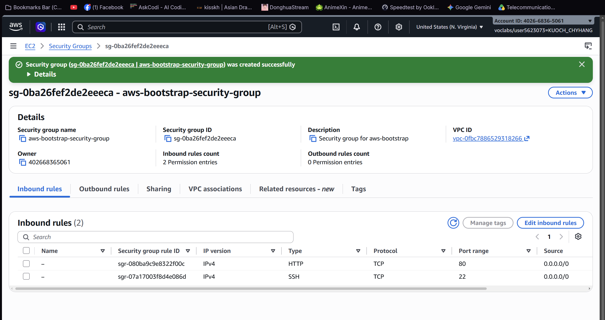

### Key pair
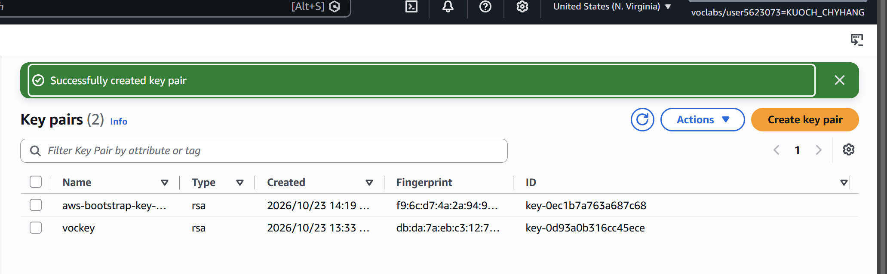

### Instance details
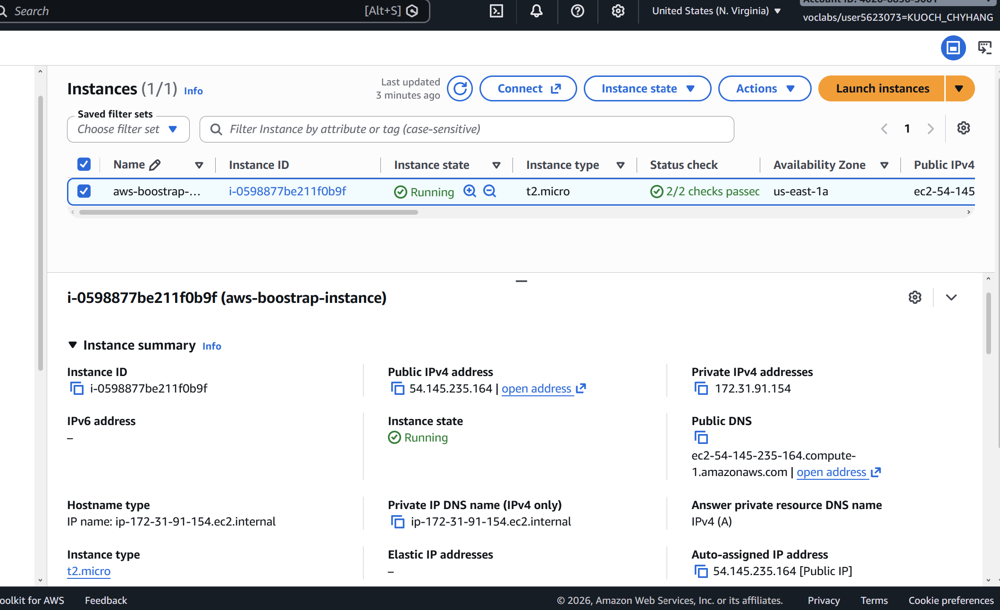

### Browser test
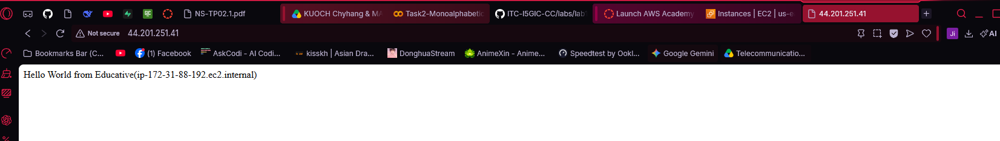

### SSH connection
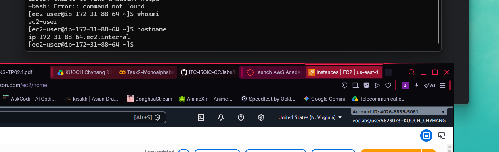

**Did you connect with your own SSH client or with EC2 Instance Connect?** I connected with my own SSH client using PowerShell and the `.pem` key file.

---

## Part 1.2 — EC2 Web Solution (Challenge)

### Launch configuration
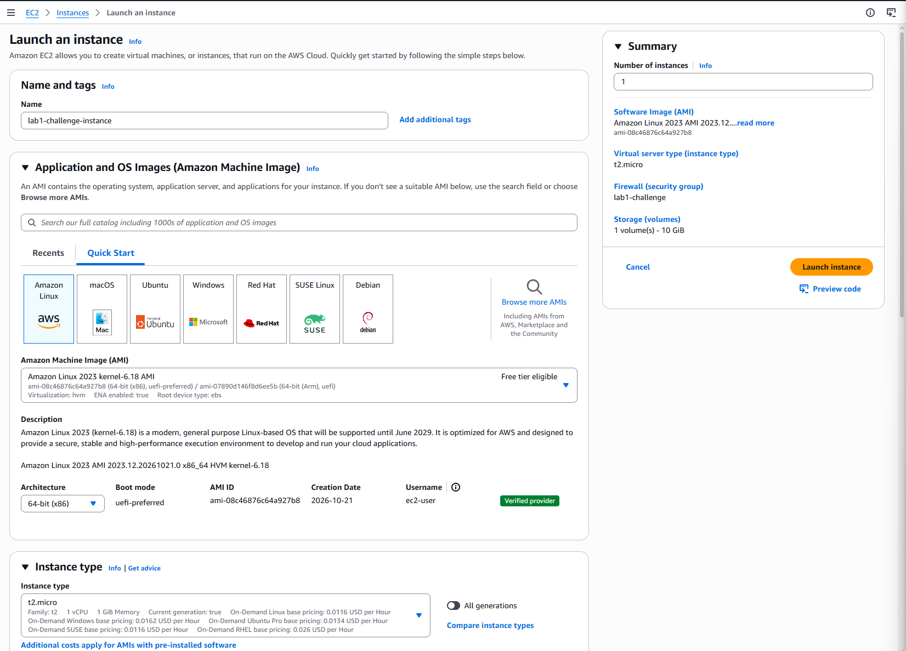

### Security group
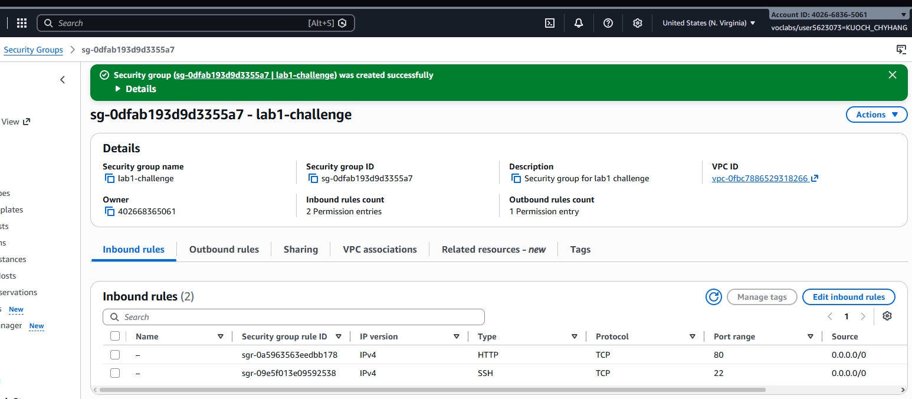

### Running instance
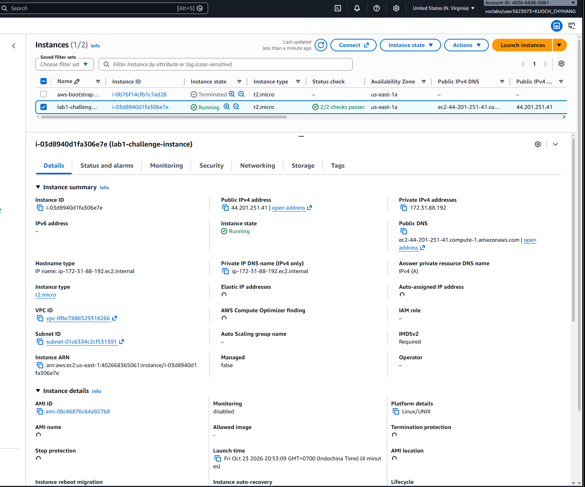

### Commands on the instance
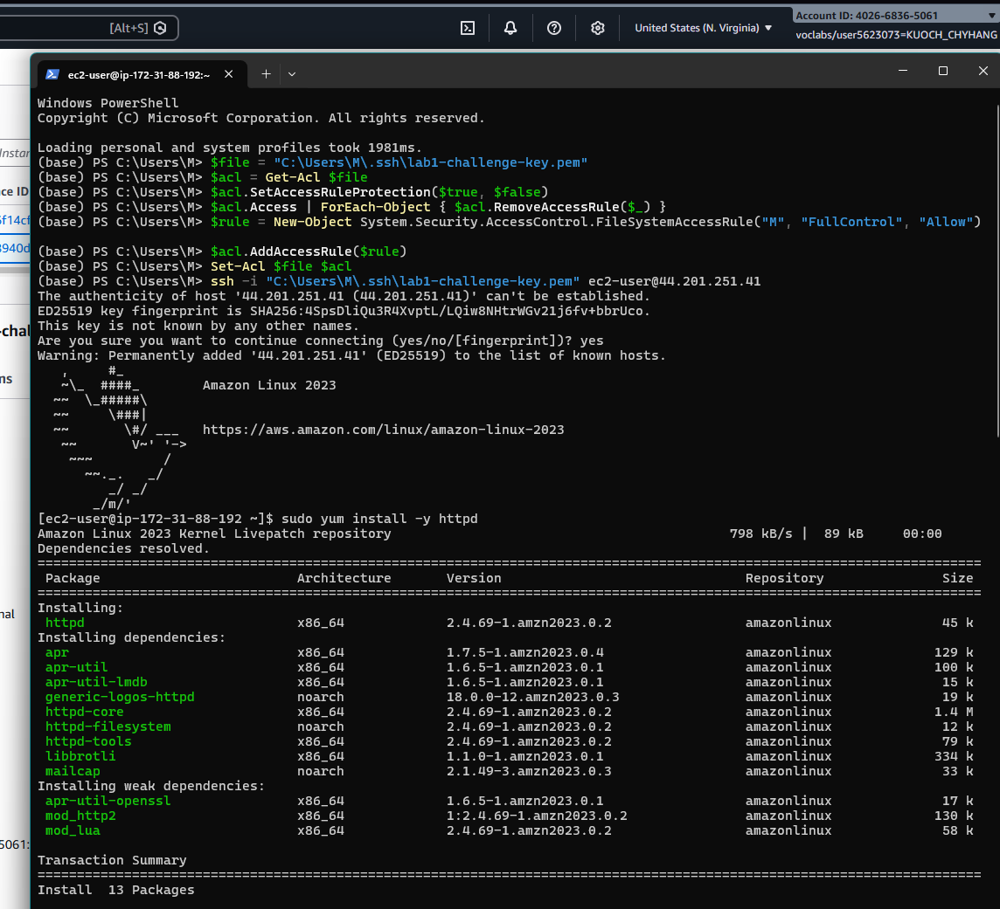
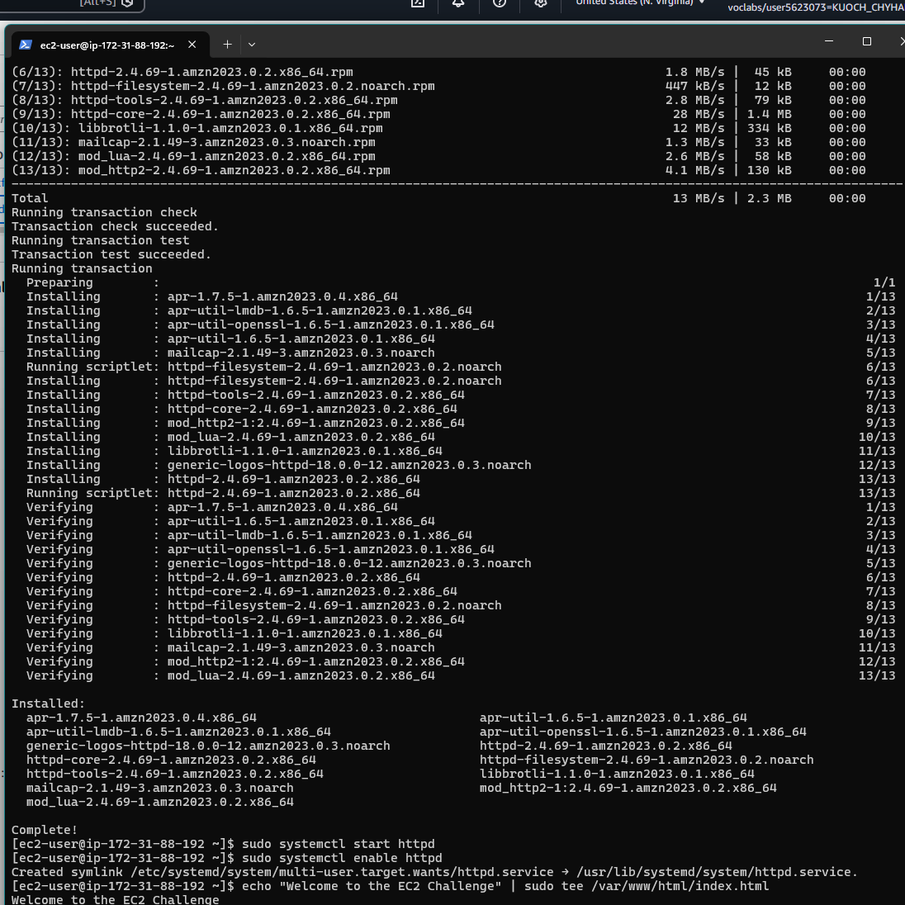

**Paste the commands you ran to install the web server and create index.html:**

```bash
sudo yum install -y httpd
sudo systemctl start httpd
sudo systemctl enable httpd
echo "Welcome to the EC2 Challenge" | sudo tee /var/www/html/index.html
```

### Browser test
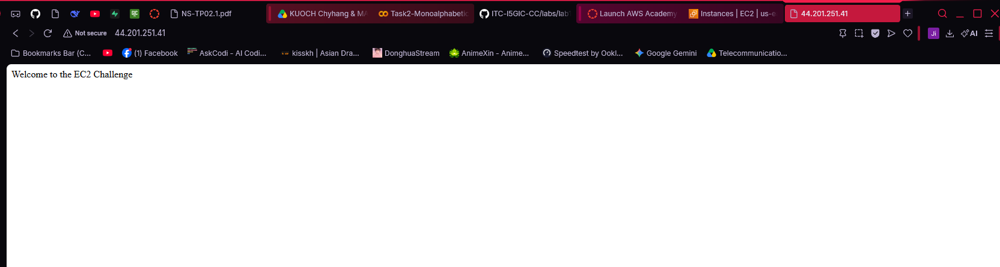

---

## Questions

1. **Your security group has an SSH rule and an HTTP rule. What does each one let you do? What would stop working if you deleted the HTTP rule?**

   The SSH rule (port 22) lets me connect to the instance remotely via a terminal to run commands. The HTTP rule (port 80) lets anyone reach the web server through a browser. If the HTTP rule were deleted, the web page would no longer be accessible from a browser — only SSH access would remain.

2. **In Part 1.1 you never logged in to install the web server. What installed it, and when did it run?**

   The User Data script installed it. It ran automatically at first boot, immediately after the instance launched, before the instance became fully available.

3. **Why does the web page open with http:// but not with https://?**

   The instance only has Apache serving HTTP on port 80. There is no SSL/TLS certificate configured and port 443 (HTTPS) is not open in the security group, so HTTPS connections are refused.

4. **Part 1.2 asked for a 10 GiB root volume. Where in the launch settings did you set it, and how can you check the size on the running instance?**

   It was set in the **Configure storage** section during instance launch, by changing the default 8 GiB to 10 GiB. On the running instance, you can verify it by running `lsblk` or `df -h` in the terminal.

---

## Clean up

- [x] Part 1.1: instance terminated, key pair and security group deleted.
- [x] Part 1.2: instance terminated, security group (and key pair, if any) deleted.
