# Cloud Lab 2 Submission — Application Load Balancer and Auto Scaling

**Student name:** Kuoch Chyhang
**Student ID:** e20220574
**Learner Lab user name:** voclabs/user5623073=KUOCH_CHYHANG
**Date completed:** 2026-11-03

---

## Task 1 — Security Groups

### LoadBalancerSecurityGroup
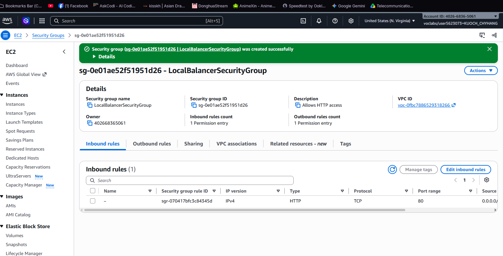

### LaunchTemplateSecurityGroup
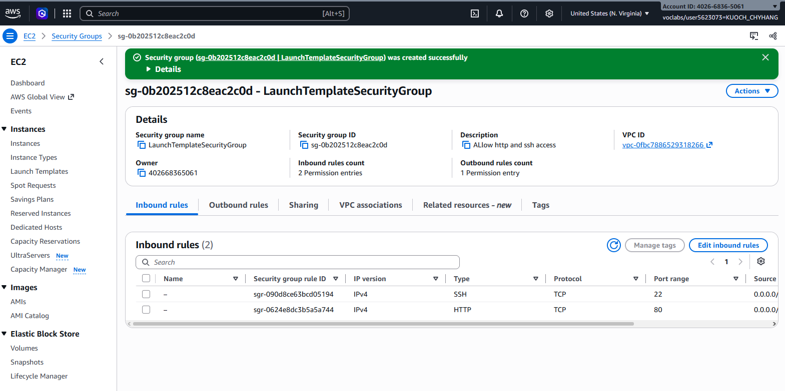

---

## Task 2 — Target Group

### Target group details
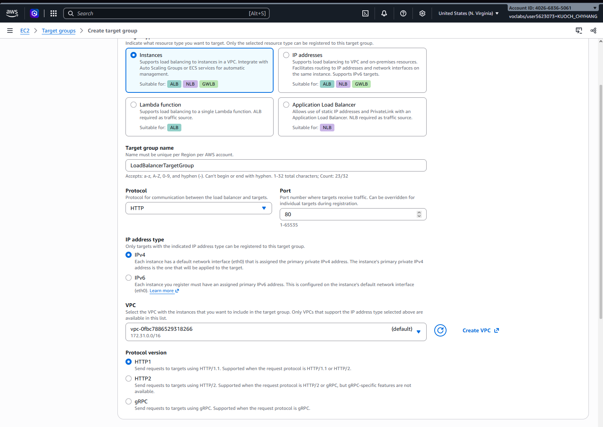

### Health checks
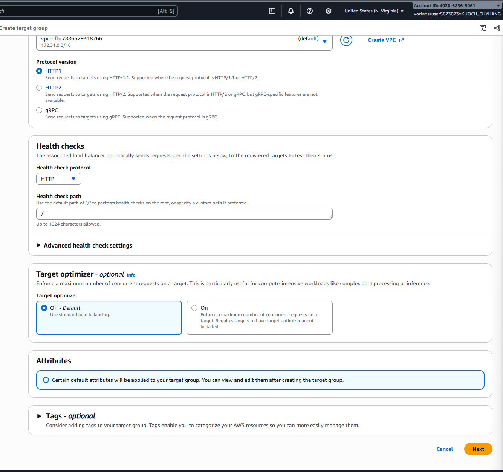

---

## Task 3 — Application Load Balancer

### Load balancer list
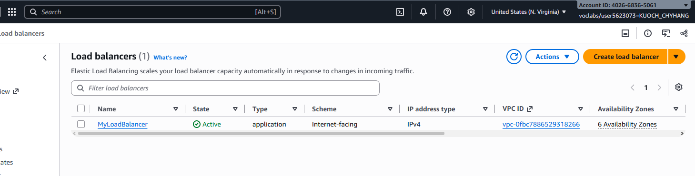

### Load balancer details
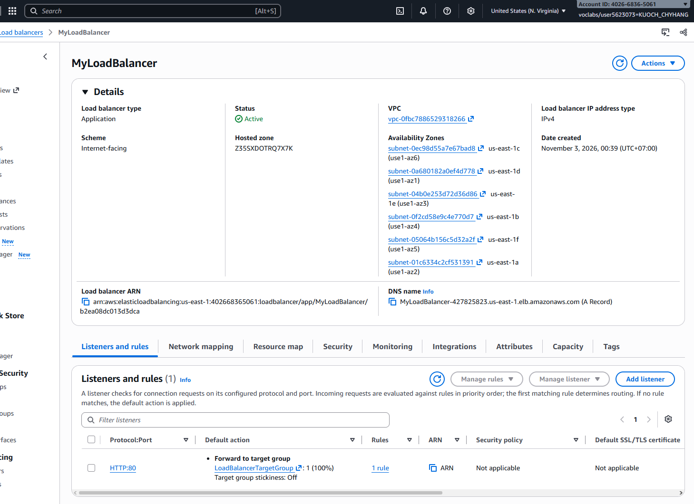

---

## Task 4 — Launch Template and Auto Scaling Group

### Launch template
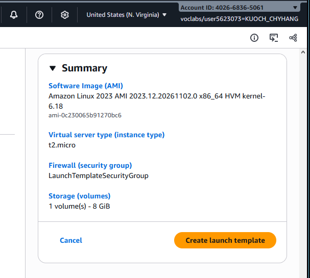

### Auto Scaling Group list
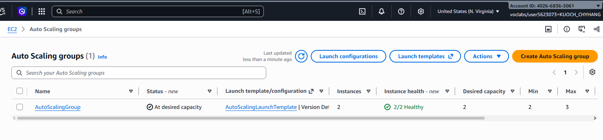

### Auto Scaling Group details
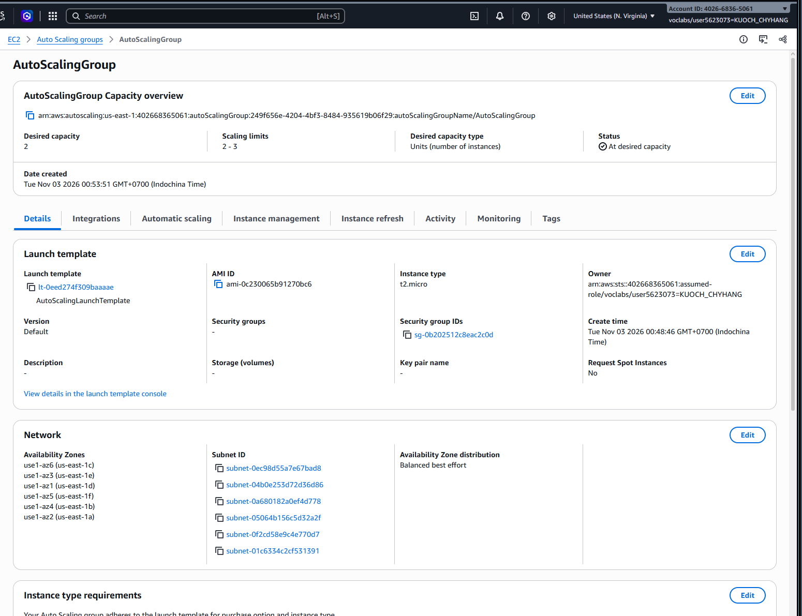
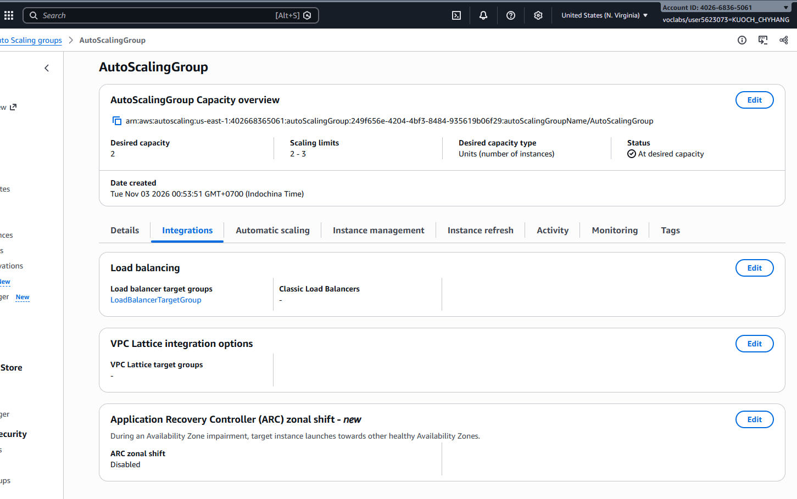

---

## Task 5 — Testing

### Browser test 1
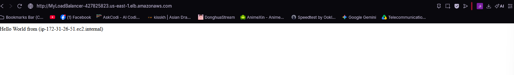

### Browser test 2 (different host)

### Stop httpd
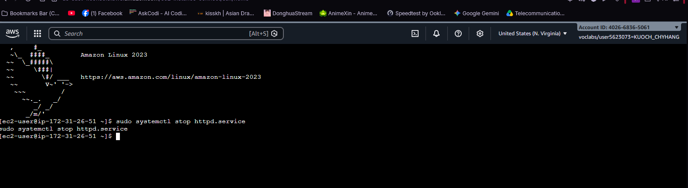

### Unhealthy target
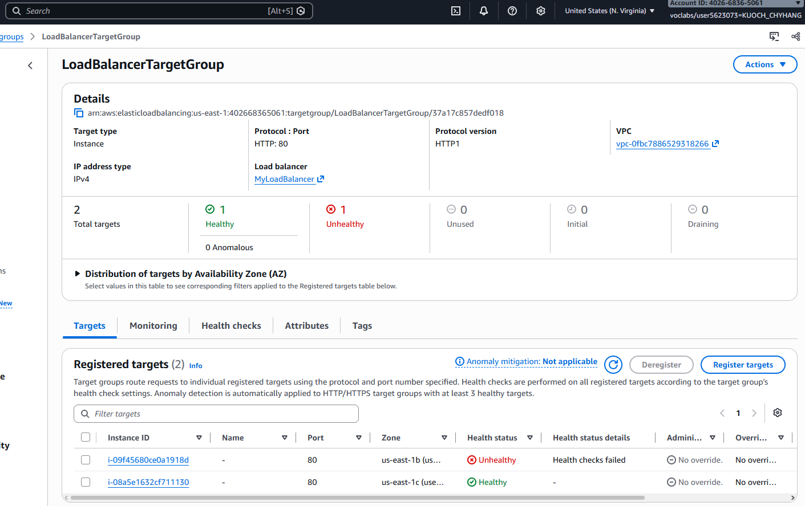

### Replaced target
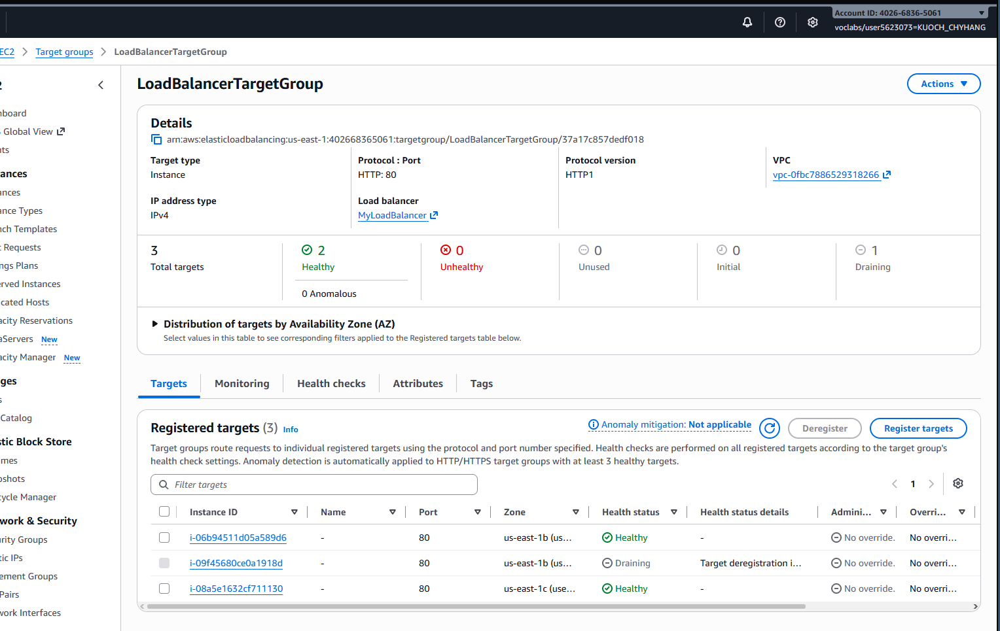

---

## Questions

1. **What does a target group do, and what happens to a target that fails its health checks?**

   A target group is a logical group of EC2 instances that a load balancer forwards traffic to. It runs health checks on each instance. If an instance fails two consecutive health checks, it is marked unhealthy and taken out of service. If the target group is attached to an Auto Scaling group, the ASG automatically launches a replacement instance.

2. **Why does the host name change when you refresh the browser?**

   The load balancer distributes requests across multiple instances in a round-robin fashion. Each refresh may be sent to a different instance, which has a different host name.

3. **The load balancer has its own security group and the instances have a separate one. Why not use one security group for both?**

   Separating them follows the principle of least privilege. The load balancer only needs to accept HTTP from the internet (port 80). The instances only need to accept traffic from the load balancer and SSH for management. Keeping them separate makes the rules clearer and more secure.

4. **You stopped httpd but the instance kept running. Why did the Auto Scaling group replace it?**

   The Auto Scaling group uses Elastic Load Balancing health checks, which test the application (HTTP response), not just whether the instance is running. When httpd stopped, the instance failed to respond to health checks, was marked unhealthy, and the ASG replaced it.

---

## Clean up

- [ ] Auto Scaling group deleted.
- [ ] Launch template deleted.
- [ ] Load balancer deleted.
- [ ] Target group deleted.
- [ ] Security groups deleted.
