# Cloud Lab 4 Submission — Amazon VPC with Public and Private Subnets

**Student name:** Kuoch Chyhang
**Student ID:** e20220574
**Learner Lab user name:** voclabs/user5623073=KUOCH_CHYHANG
**Date completed:** 2026-11-06

---

## Task 1 — VPC

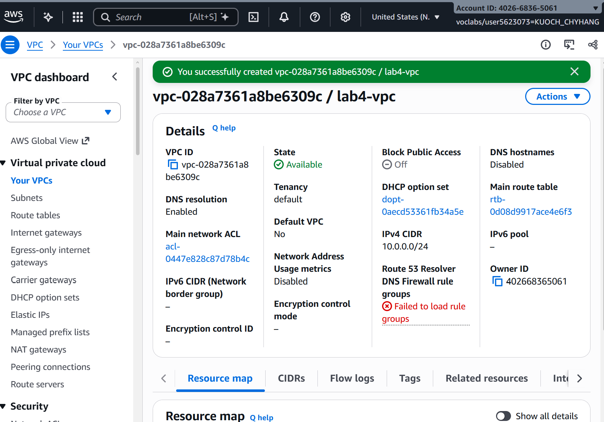

---

## Task 2 — Internet Gateway

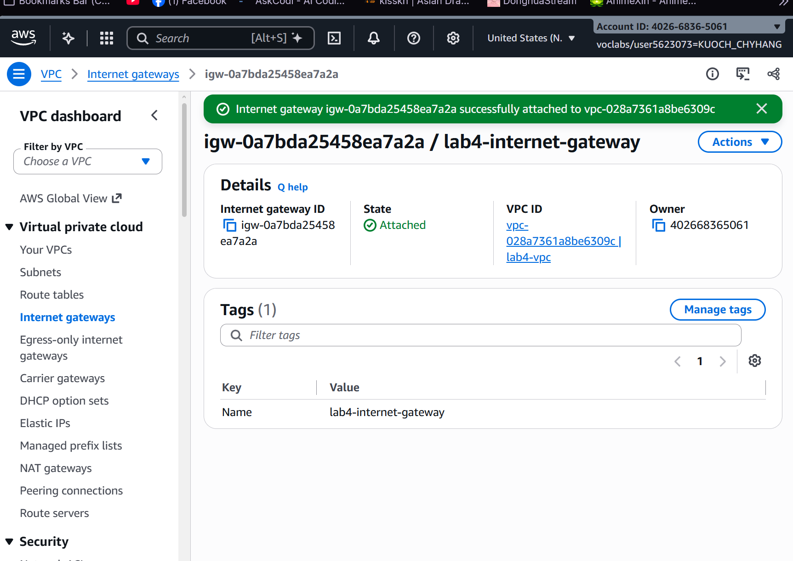

---

## Task 3 — Public Subnet

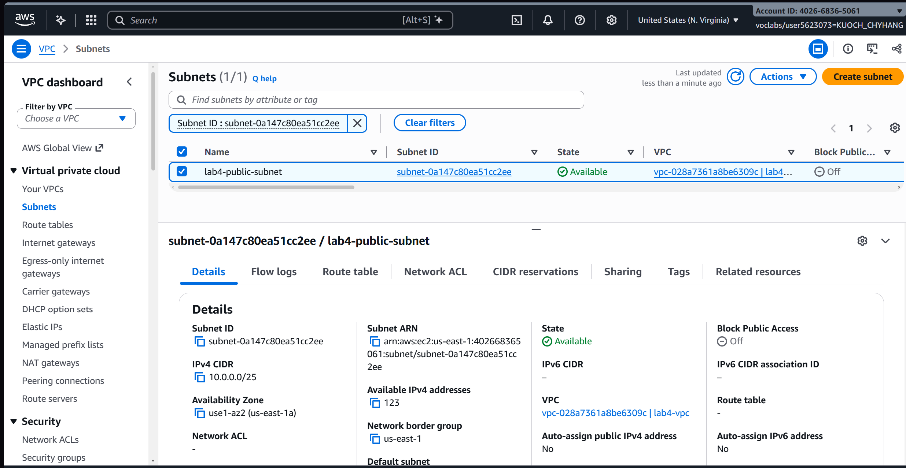

---

## Task 4 — Public Route Table

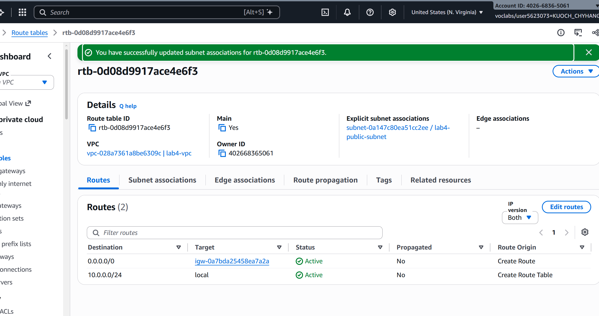

---

## Task 5 — EC2 Instance in Public Subnet

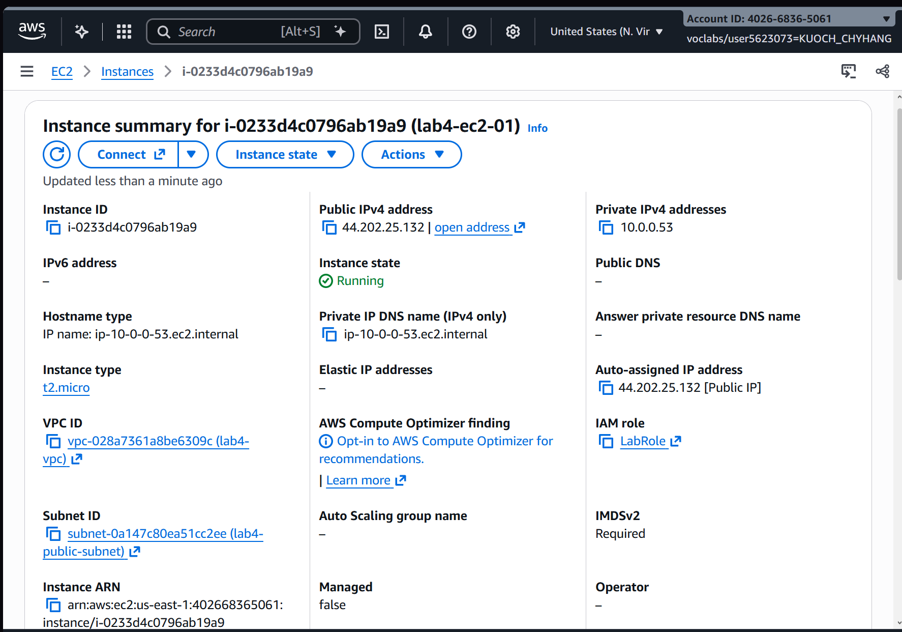

---

## Task 6 — Test Internet Access (Public)

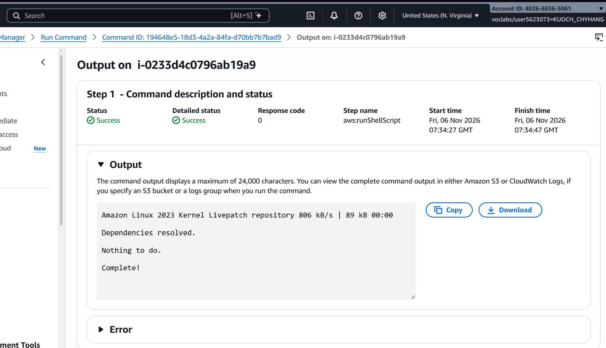

---

## Task 7 — Private Subnet

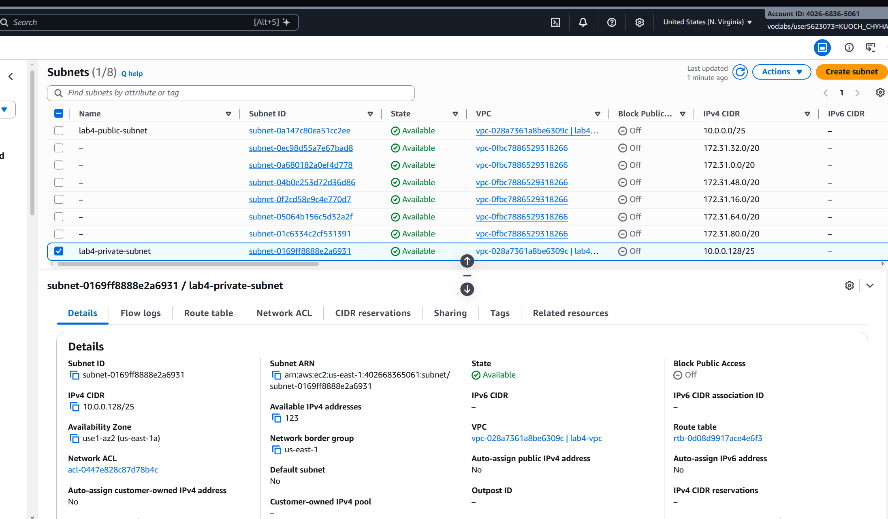

---

## Task 8 — NAT Gateway

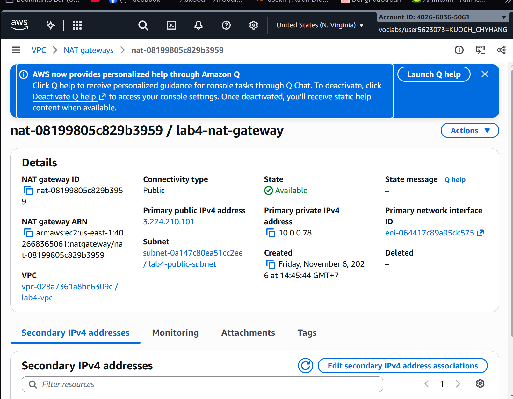

---

## Task 9 — Private Route Table

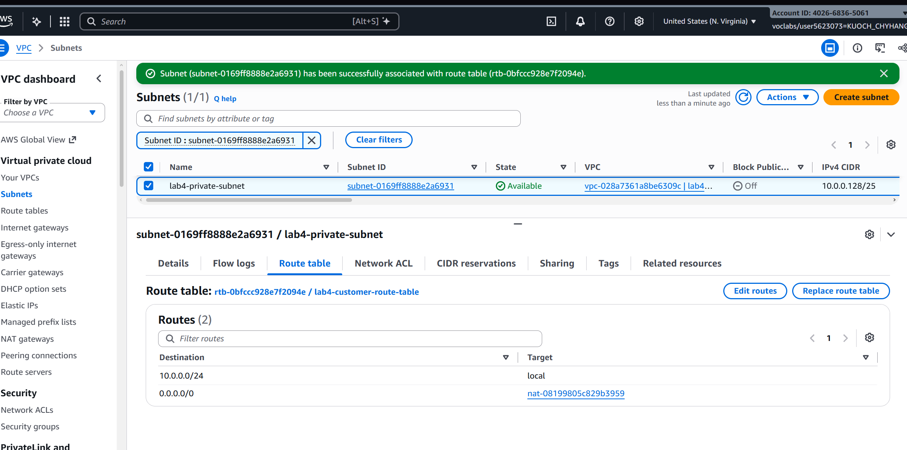

---

## Task 10 — EC2 Instance in Private Subnet

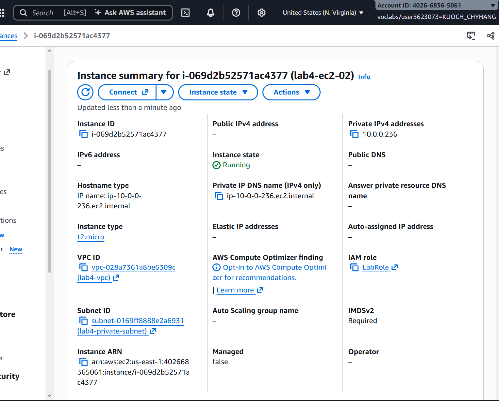

---

## Task 11 — Test Internet Access (Private)

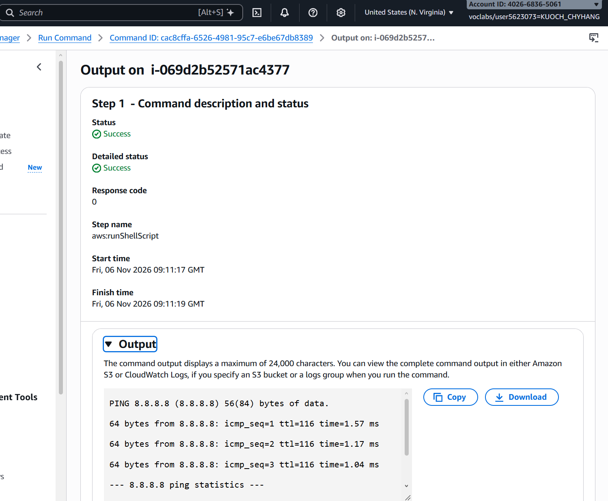

---

## Questions

1. **What is the difference between a public subnet and a private subnet in this lab?**

   The public subnet has a route to the internet gateway, so instances in it can send and receive traffic directly from the internet. The private subnet has no route to the internet gateway — its traffic goes to the NAT gateway instead, which forwards it to the internet gateway. Instances in the private subnet can reach the internet but cannot be reached from it directly.

2. **Why does the private instance have no public IP address, and how does it still reach the internet?**

   The private instance has Auto-assign public IP disabled because it should not be directly accessible from the internet. It reaches the internet through the NAT gateway, which is in the public subnet. The NAT gateway has an Elastic IP and acts as an intermediary — it sends the private instance's outbound traffic to the internet and returns the response.

3. **What does the LabInstanceProfile do, and why is it needed?**

   The LabInstanceProfile attaches the LabRole IAM role to the instance. This allows AWS Systems Manager (SSM) to connect to and run commands on the instance without needing SSH or a key pair. Without it, SSM cannot authenticate with the instance.

4. **Why is a NAT gateway placed in the public subnet rather than the private subnet?**

   The NAT gateway needs internet access itself to forward traffic on behalf of private instances. It must be in the public subnet so it can route traffic through the internet gateway. If it were in the private subnet, it would have no path to the internet.

---

## Clean up

- [ ] EC2 instances terminated.
- [ ] Routes deleted.
- [ ] NAT gateway deleted.
- [ ] Elastic IP released.
- [ ] Internet gateway detached and deleted.
- [ ] VPC deleted.
