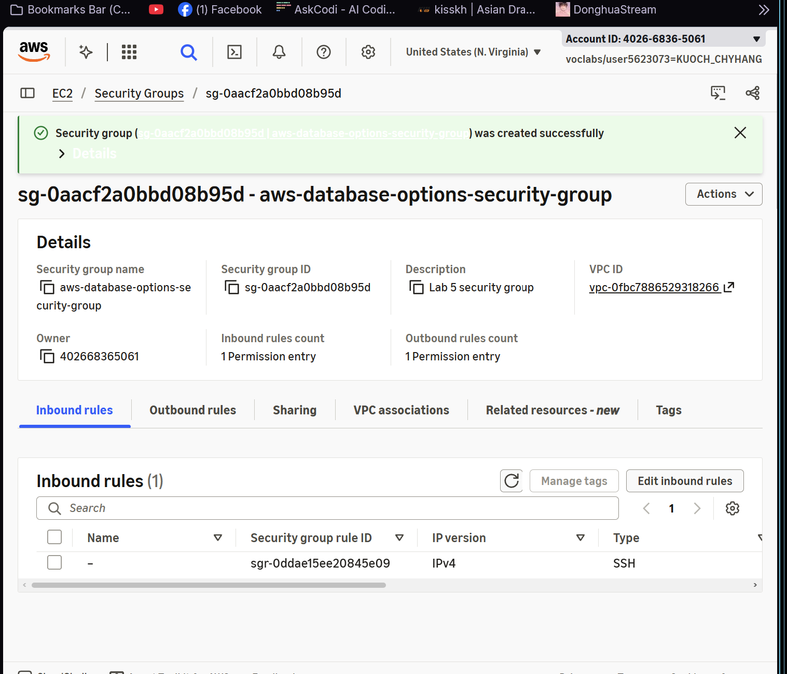
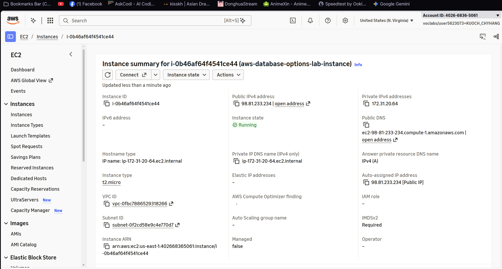
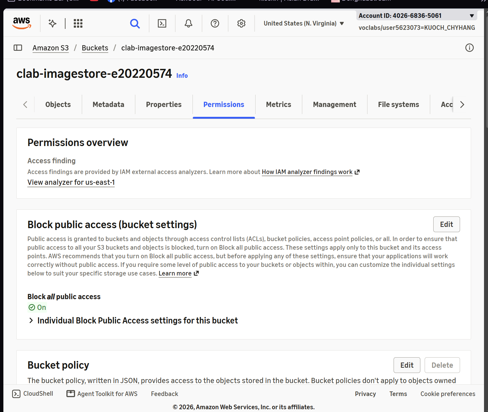
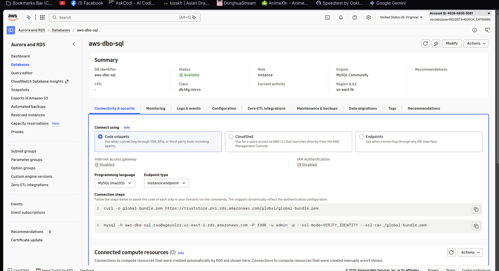
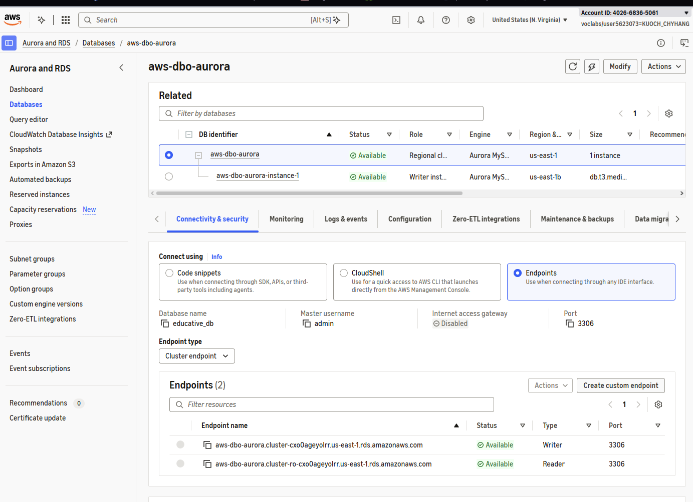
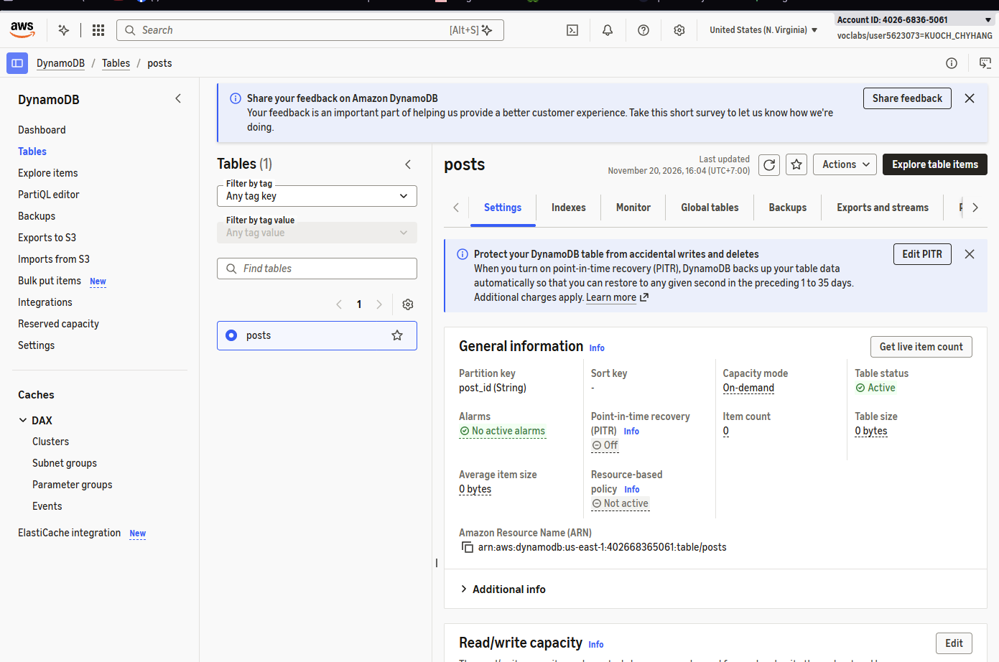
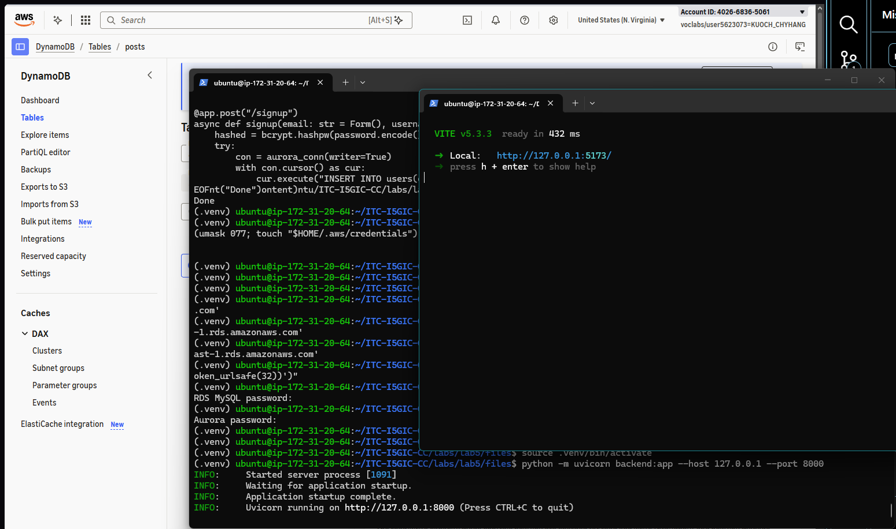
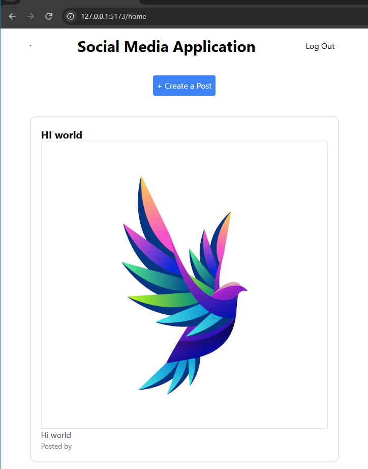
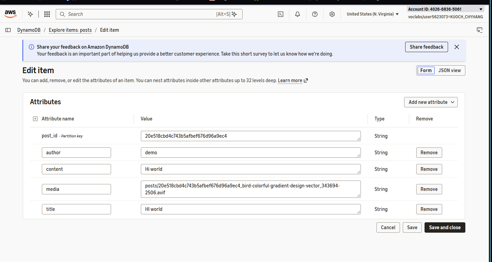
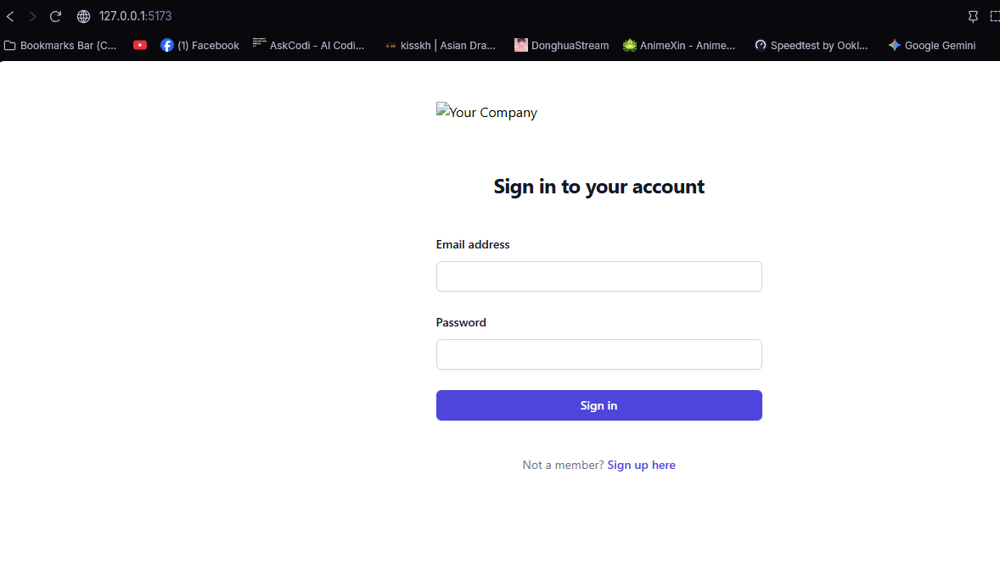

# Cloud Lab 5 Submission — Social Posts Microservice with AWS Databases

**Student name:** Kuoch Chyhang
**Student ID:** e20220574
**Learner Lab user name:** voclabs/user5623073=KUOCH_CHYHANG
**Date completed:** 2026-11-20

---

## Task 1 — Security Group

---

## Task 2 — EC2 Instance

---

## Task 3 — S3 Media Bucket

---

## Task 4 — RDS for MySQL

---

## Task 6 — Aurora Endpoints

---

## Task 8 — DynamoDB Posts Table

---

## Task 9 — App Start

---

## Task 10 — App in Browser

---

## Task 10 — Final Infrastructure

---

## Task 10 — Signup and Post

---

## Questions

1. **Why does the microservice use three different database services (Aurora, RDS MySQL, DynamoDB) instead of just one?**

   Each service is optimized for a different access pattern. Aurora MySQL handles user accounts where relational consistency and read scaling (writer/reader endpoints) matter. RDS MySQL stores the post index as a simple relational table. DynamoDB stores post content as flexible key-value items with low-latency single-key lookups by `post_id`. Using each service where it fits best is the principle of polyglot persistence.

2. **What is the difference between the Aurora writer endpoint and the reader endpoint?**

   The writer endpoint always connects to the primary (write-capable) instance in the cluster. The reader endpoint distributes read traffic across available replicas. In this lab the cluster has no replica, so both endpoints reach the same instance — but separating them in the code means adding a replica later requires no code change.

3. **Why is the S3 bucket kept private, and how does the browser display images?**

   The bucket is private so images are not publicly accessible. When the browser requests a post, the FastAPI service calls S3 to generate a short-lived pre-signed URL for each image and returns that URL to the client. The browser uses the signed URL directly, which expires after a short time and cannot be reused by others.

4. **What does DynamoDB's partition key do, and why is `post_id` a good choice for it?**

   The partition key determines which physical partition stores an item and is used for direct single-item lookups. `post_id` is a good choice because every post is retrieved individually by its ID — the access pattern is always "get this specific post", which maps directly to a partition key lookup with O(1) latency.

---

## Post Trace

| Field | Value |
|---|---|
| `post_id` (DynamoDB) | `20e518cbd4c743b5afbef676d96a9ec4` |
| `media` key (DynamoDB → S3) | `posts/20e518cbd4c743b5afbef676d96a9ec4_bird-colorful-gradient-design-vector_343694-2506.avif` |
| `id` row in RDS `user_post` | `20e518cbd4c743b5afbef676d96a9ec4` |

---

## Clean up

- [x] RDS instance deleted (no final snapshot).
- [x] Aurora cluster and writer deleted (no final snapshot).
- [x] DynamoDB `posts` table deleted.
- [x] S3 bucket emptied and deleted.
- [x] EC2 instance terminated.
- [x] Security groups deleted.
